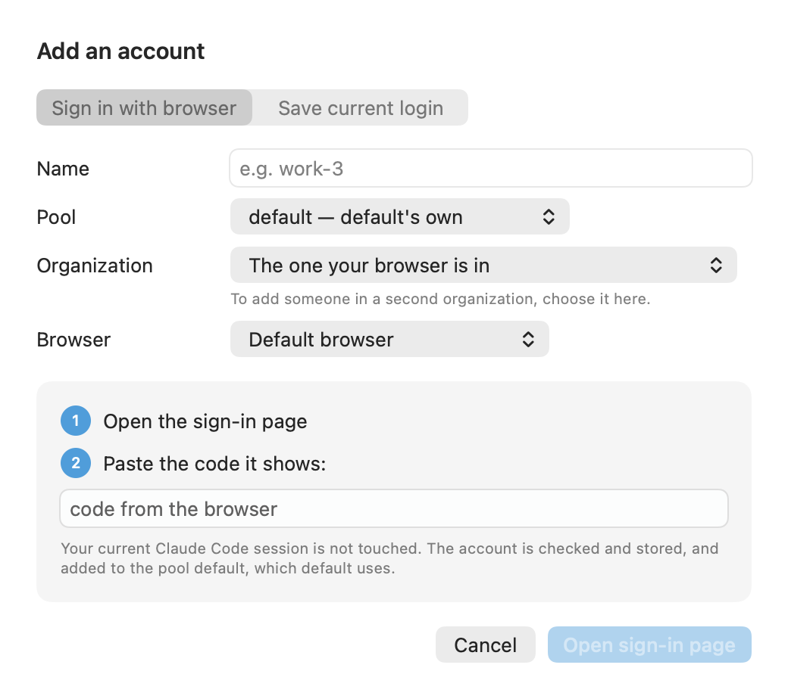
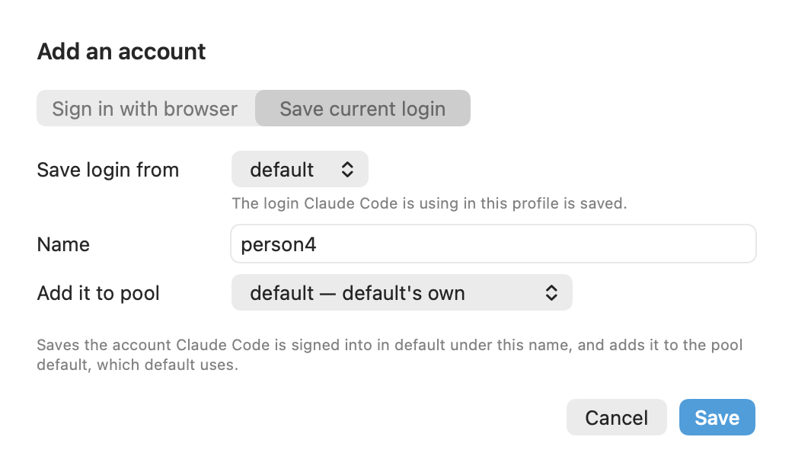

# Add account

The sheet that adds an account, or signs in to one again: through a browser, or by saving the login Claude Code has now.

See also: [cs accounts → login, add](../cli/accounts.md) · [GUIDE → Adding an account](../GUIDE.md#adding-an-account) · [Settings → Accounts](settings-accounts.md)

It opens from **+ Add Account** in the popover (for the followed profile),
**Add Account** in [Settings → Accounts](settings-accounts.md) (for the
first profile), and **Sign In…** in an account's ⋯ menu, the popover's and
Overview's **Sign In…**, a Health fix or a re-login notification (that
account, in its profile).

## Sign in with browser

| field | what it is | default |
|---|---|---|
| **Name** | the account's name in claudeswitch. Any name works; it is pinned to whichever seat signs in | |
| **Pool** | where a new account goes (D37): every pool, named with the profiles that use it (`“team”, used by “default” and “work”`, `“default”, the profile’s own pool`), and No pool, which `default` uses last. It starts on a pool only the profile it was opened from uses, so nothing is shared unless you choose it. With only one choice the row says it rather than offer a pop-up; when that choice is No pool (one profile and no pools) there is nothing to choose and no row at all: the sentence under the steps says the account is added to `“default”`. An account that already exists stays where it is: the row is **Used by**, the profiles that may use it, with a note naming its pool (`The account “team-1” is in the pool “team”, which “default” and “work” use. To change that, move it to another pool in Accounts.`). With an older claudeswitch this row is **Profile**, said rather than offered when there is one profile | that profile's unshared pool |
| **Organization** | the organization to sign in to: one an account here is already in (`Same organization as “personal”, “work-1” +2`), another pasted by id (**Another organization…**), or whichever the browser is in. Choose one to add a person in a second organization. An id that cannot be asked for is marked with a warning sign (`Paste the organization’s id: letters, digits and dashes.`). An account signing in again asks for its own | The one your browser is in |
| **Browser** | the browser the sign-in page opens in. A browser signs in as the account it already holds, so pick one signed in to this account | Default browser |

**Open Sign-In Page** runs `cs login <name> --direct --no-open`, with
`--pool <pool>` or `--no-pool` for the pool chosen (`--profile <profile>`
with an older claudeswitch), and `--browser` and `--org` when set, then
opens the page. The button waits for a name, and says so (`Enter a name to
continue.`). Beside the spinner the sheet says what it waits for: `Opening
the sign-in page…`, then, after **Finish**, `Checking the account…`.
**Cancel** while the page is being opened opens nothing. Every pop-up takes
the field column's full width. An account signing in again shows its name
as text, not a field, and sends neither a pool nor an organization: it
stays in its pool and asks for its own organization; **Used by** and its
note name the pool, so the sentence under the steps does not. Step 2 is
dimmed until the page is open. Sign in, then paste the code the page shows;
the app finishes with `cs login <name> --code <code>`. The credential is
checked, stored and added to the pool, as one sentence under the steps says
(`The login Claude Code is using now is not touched. The account is checked
and stored in the pool “default”, which “default” uses.`). With one profile
and no pools it reads `… checked, stored and added to “default”.`

The CLI refuses a mismatch: another organization than the one chosen, a name
already pinned to another seat, or a seat already stored under another name.
The sheet shows its message and opens again, so you can choose another
organization or browser and sign in again. A seat already stored reads, in
the app's words, `This person in this organization is already saved as
“work-1” (person1@example.com, Example). Nothing was stored.`, with the
next step under it.

## Save current login

| field | what it is | default |
|---|---|---|
| **Save login from** | the profile whose Claude Code login is saved | the followed profile |
| **Name** | the name to save it under, suggested from the account | suggested |
| **Add it to pool** | the pool it goes into, as **Pool** above, with no row when No pool is the only choice. When the source profile uses that pool too, it keeps the login until its own rotation moves on; when it does not, it moves off it. The sheet says which, with a warning sign (`It is still the login in “default”, which will move off it — “work” can use it after.`). For an account that already exists this row is **Used by** and is not chosen; with an older claudeswitch it is **Add it to profile** | that profile's unshared pool |

**Save** runs `cs add <name> --from <profile> --pool <pool>` (or `--no-pool`;
`--profile <profile>` for an account that already exists, or with an older
claudeswitch). Use it after `/login` in Claude Code as the account you want
to add. With the name left empty it saves under the name suggested, so
`Enter a name to continue.` shows only when there is no suggestion; the
spinner says `Saving the login…` (`Reading the login…` while the name is
suggested). The name in the screenshot is an example.

[← Documentation index](../README.md)
