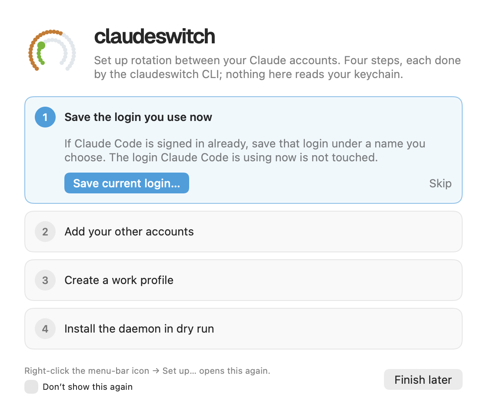
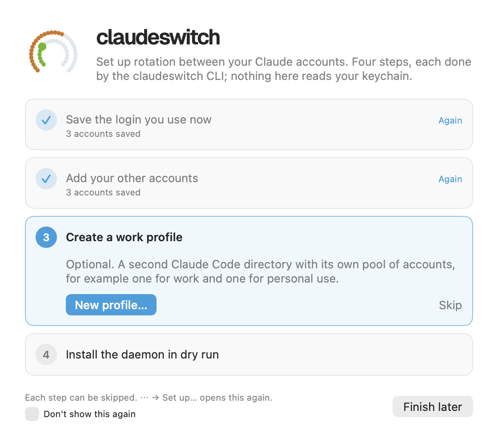

# First-run setup

The window that opens when the app starts and there is no claudeswitch
config yet. It does what `cs setup` does, one step at a time, through the
CLI's JSON forms.

See also: [Add account](add-account.md) · [Settings → Profiles](settings-profiles.md) · [Settings → Daemon](settings-daemon.md) · [cs setup](../cli/setup.md)

## When it opens

- **At launch**, when the config file is missing: the path
  `cs config --json` reports, or `~/.config/claudeswitch/config.toml` when
  the CLI cannot be read. Not when **Don’t show this again** is ticked.
- **From the menu-bar icon's menu → Set up…** (right-click or Control-click
  the icon), at any time, ticked or not.

**Finish later** (Escape) closes it. Nothing is lost: each step's state is
read again from the CLI when the window opens. Once every step is done or
skipped, **Done** closes it, with Return or Escape.

The foot says where it opens again: *Right-click the menu-bar icon → Set
up… opens this again.*

**Don’t show this again**, a checkbox at the foot of the window, stops it
opening by itself at launch. It is kept in the app's preferences
(UserDefaults, `firstRunDontShowAgain`) and unticked the same way, from
the icon's menu → Set up….

The window keeps its middle where it is as steps open and close, until you
drag it elsewhere.

## The steps

Each step can be skipped. A step counts as done when what it does is
already true, whether this window did it or not. A finished step keeps a
link:

- **Add another**, on steps 2 and 3, opens the step's sheet again (Add
  account, New profile); the step stays done.
- **Open**, on step 4, opens [Settings → Daemon](settings-daemon.md),
  where the service turns live or is uninstalled. It never installs again.
- **Open**, on step 1, opens the step again in the window. It is the open
  step, though an account is saved already, until you press **Continue**
  or **Skip**.
- **Do it now**, on a skipped step, opens it again too. It is done as soon
  as what it does is true, as if it had never been skipped (step 2 when you
  press **Continue**).

Return runs the open step's button, and **Done** once every step is.

| step | what it does | runs | done when |
|---|---|---|---|
| **1. Save the login you use now** | if Claude Code is signed in already, opens [Add account](add-account.md) on **Save current login**, with the name the CLI suggests; the login Claude Code is using now is not touched | `add <name> --json` | the config has an account. Its line says `Saved as “work-1”` only when the CLI knows the login in use is that account; the count of saved accounts is step 2's |
| **2. Add your other accounts** | opens [Add account](add-account.md) on **Sign in with browser**, as often as you like. Its line counts the accounts saved; **Continue** moves on once one is | `login <id> --direct --json`, then `login <id> --code <code> --json` | you press Continue |
| **3. Create a work profile** | optional. Opens the [New profile](settings-profiles.md) sheet | `profile create --json` | a profile other than `default` exists |
| **4. Install the daemon in dry run** | installs the background service in dry run: it reads usage and decides, but never switches. Turn it live in [Settings → Daemon](settings-daemon.md). **Install (dry run)** shows only once `daemon status --json` has said the service is not installed: until it answers the step says **Reading the service…**, and if it fails, the failure with **Try Again**. An installed service is never installed over, since that would make a live one dry run | `daemon status --json`, then `daemon install --dry-run --json` | `daemon status --json` says the service is installed |

## The config it starts

`add --json` writes each account into the config, but does not create the
file. So before steps 1 to 3 the window asks the CLI for an empty one,
[`cs init --empty --json`](../cli/setup.md#cs-init), at the path the CLI
reads (mode 0600, its folder 0700): comment lines and no settings. Every
setting keeps its default; an existing config is never touched. The app
itself never writes claudeswitch's files.

A claudeswitch older than 0.6.1 has no `init --empty`. The window then says
so, with the update steps, and suggests running `cs setup` in Terminal
instead.

## Without the binary

Every step runs `claudeswitch`. When it is missing, or too old for this app,
the window says so with the install steps; when it speaks a newer contract
than the app, it says to update the app. The step buttons are off until
then. The banner's × closes it, and a line stays by the steps saying why
their buttons are off: `claudeswitch is missing: install it first`,
`claudeswitch is too old: update it first`, or `claudeswitch is newer than
this app: update the app first`.

[← Documentation index](../README.md)
