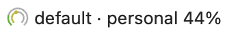
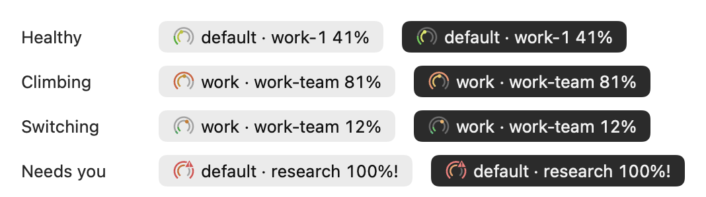

# Menu bar

The menu-bar item: the live Twin rings glyph, the followed profile's live account and its utilization.

See also: [Popover](popover.md) · [Settings → Advanced](settings-advanced.md) · [Concepts → the two windows](../concepts.md#the-two-windows-and-thresholds) · [BRAND.md](../BRAND.md)

## The label

The text after the glyph is `<profile> · <account> <percent>`:

| part | what it is |
|---|---|
| profile | the profile the menu bar follows; left out when there is only one profile |
| account | that profile's live account |
| percent | the account's binding utilization: whichever of the session (5-hour) and week windows is closer to its switch threshold |
| `!` at the end | the account is over its threshold, was refused, or needs sign-in |

A profile or account name longer than 16 characters is cut in the middle
(`client-integration` reads `client-i…gration`), so the figure and its `!`
stay in view and a long title does not push the item behind the notch.

Other forms:

- `<profile> · no account` (`scratch · no account`) when the followed profile has no live
  account, or `–` alone with one profile.
- `cs –` when there is no profile to follow and no account is live.
- `cs …` while the app is still reading its first state.
- A question mark instead of the rings when the `claudeswitch` binary is
  missing, older than 0.5.1, or speaks a newer contract than this app.
  Open the popover for how to install it.

The menu bar follows the profile marked **Menu bar** in the
[popover](popover.md#cards). **Show in Menu Bar** on another card, or
**Shown in menu bar** in [Settings → Profiles](settings-profiles.md), changes
it. With no choice made, it follows `default`.

The label reads the live account and its readings from the state file,
and, as the popover does, each profile's thresholds from `cs profile list
--json` and rotation's next step (the switching state) from `cs why
--json`. It is redrawn when any of them changes and never animates, so
Reduce Motion has nothing to stop.

## The glyph

The glyph is two rings of dots. The **outer ring is the session**, the
**inner ring is the week**, each lit up to the live account's reading and
coloured by it: green when little is used, amber at half, red when the window
is spent. A small dot on the inner ring, the satellite, sits at the week's
reading. Unlit dots take the menu bar's own colour, light or dark. Trouble is
also shown by shape (a warning mark and the trailing `!`), so it reads without
colour.

| state | when | what changes |
|---|---|---|
| **Healthy** | the live account has room | the rings show the readings; the satellite sits at the week |
| **Climbing** | the live account is near its switch threshold | the same drawing, with the rings nearly full |
| **Switching** | rotation has decided to move the profile to another account | the satellite moves to the incoming account's week |
| **Needs you** | the live account was refused, or needs sign-in | a warning mark replaces the satellite, and the text ends in `!` |

VoiceOver reads the item as, for example, "ClaudeSwitch: default · personal,
week 44%, session 24%", followed by "nearing its switch threshold",
"switching to work-team (week 12%)", "personal was refused" or "personal
needs sign-in" when they apply.

## Icon only

**Icon only in the menu bar** in [Settings → Advanced](settings-advanced.md)
hides the text and keeps the rings. Default: off. It saves space on a crowded
menu bar, or on a MacBook whose notch hides items: see
[README → Troubleshooting](../../README.md#troubleshooting).

[← Documentation index](../README.md)
