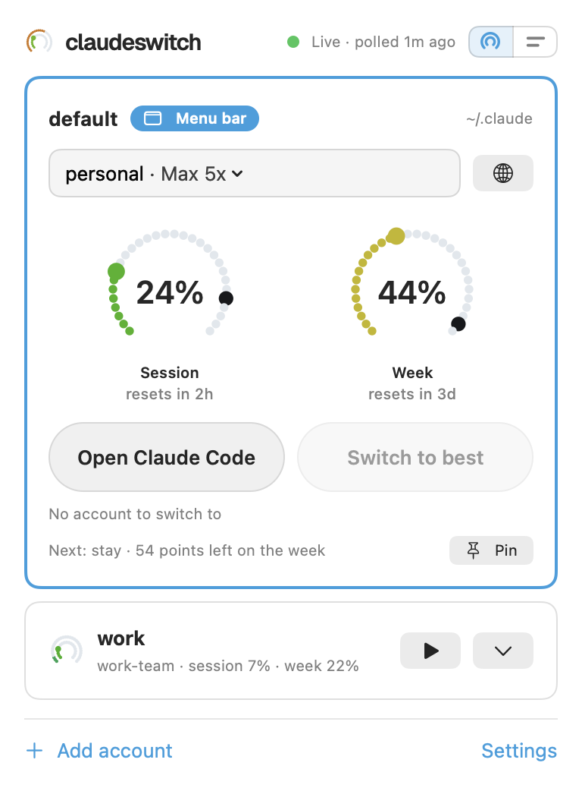
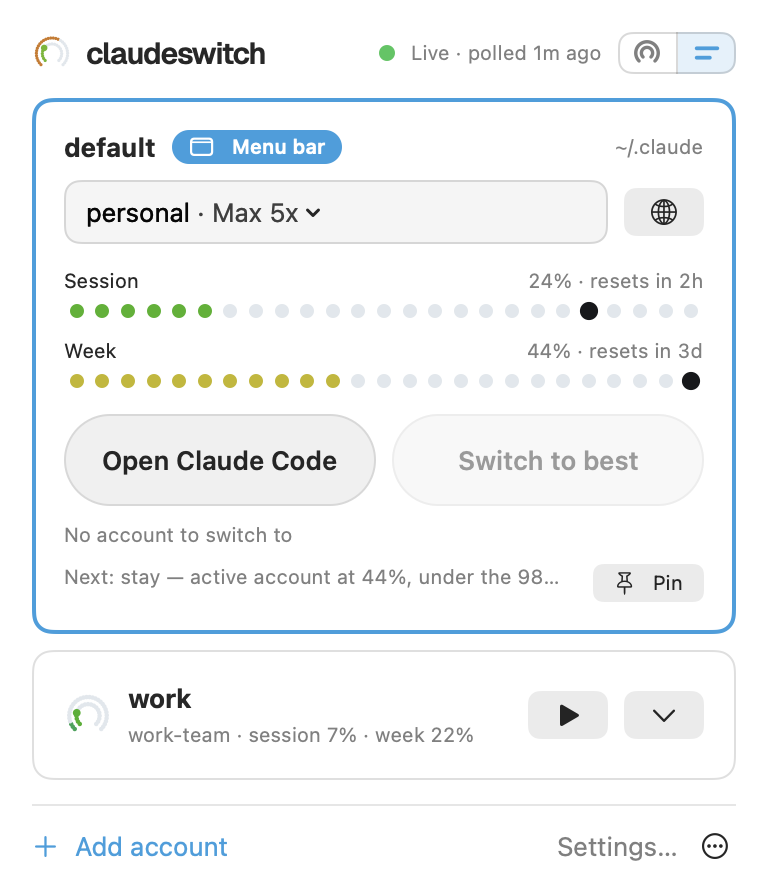
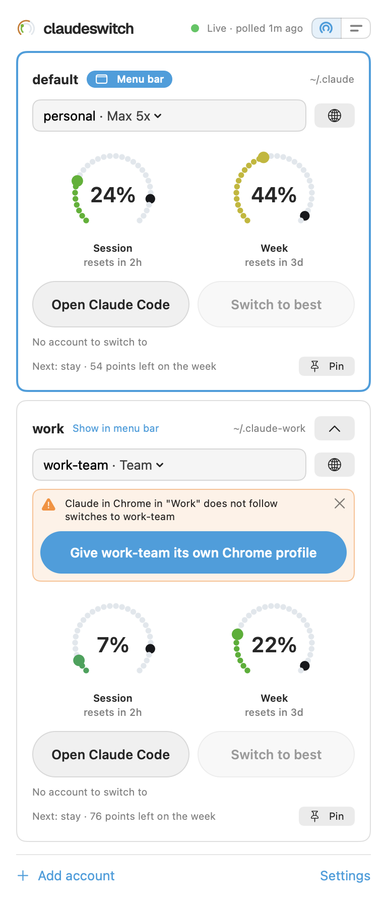
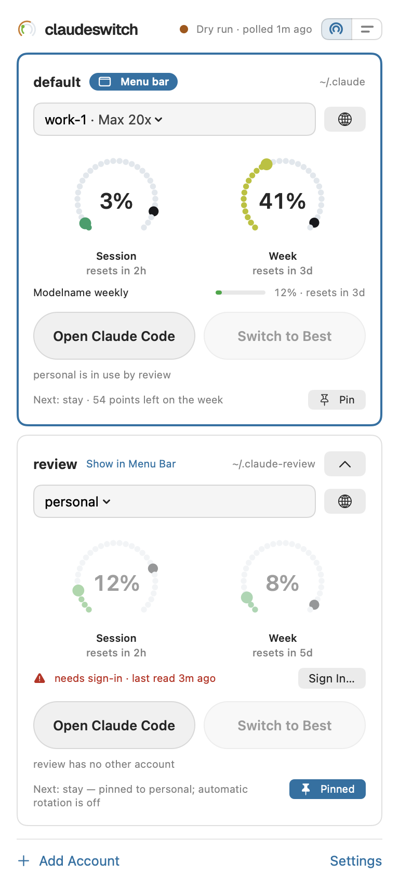
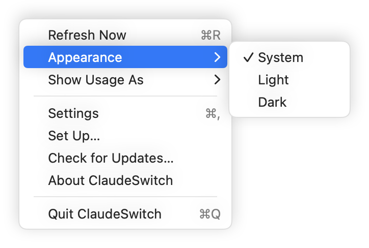
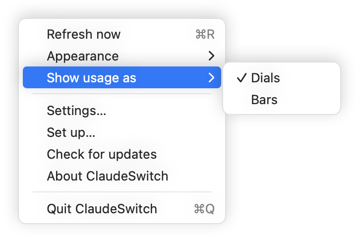

# Popover

The window that opens from the menu-bar glyph: the daemon, one card per profile, and the actions you use day to day.

See also: [Menu bar](menu-bar.md) · [Claude in Chrome in the app](chrome.md) · [cs status](../cli/status.md) · [cs accounts](../cli/accounts.md) · [Concepts](../concepts.md)

<table>
  <tr>
    <td align="center"></td>
    <td align="center"></td>
  </tr>
  <tr><td align="center">Dials</td><td align="center">Bars</td></tr>
</table>

Dark mode: [dials](../images/popover-dials-dark.png),
[bars](../images/popover-bars-dark.png).

## Header

| control | what it does | default |
|---|---|---|
| **Live** / **Dry run** | the daemon's mode: green when live, orange in dry run, then how long since it polled (`polled 1m ago`). Red **Not polling for 21m ›** when it has stopped, or **No daemon ›** when none ever ran, in the text's full colour; click it to open [Settings → Daemon](settings-daemon.md), where it is started. Change the mode in [Settings → Daemon](settings-daemon.md) or with `cs daemon live` / `cs daemon dry-run` | as installed: dry run |
| dials / bars switch | the two small buttons at the top right: show session and week as dials or as bars. The same setting as **Show usage as** in the [icon's menu](#the-icons-menu) and **Usage in the popover** in [Settings → Advanced](settings-advanced.md) | Dials |

A small spinner beside them shows while the app reads. Before its first read the popover says **Reading…**, and with no state file yet, **No state yet: is the daemon installed? Run `claudeswitch setup`.**

## Cards

One card per profile. The card of the profile the menu bar follows is open
and outlined in the accent colour. With more than one profile it is marked
**Menu bar**, and any other card you open has **Show in menu bar** next to
its name, which makes the menu bar follow it; with one profile neither
shows. The other profiles are compact rows. An opened card has a chevron to
close it.

A compact row has the live account's small rings (session outside, week
inside, as in the [menu-bar glyph](menu-bar.md#the-glyph); a warning mark
when the account needs sign-in or was refused, an empty ring when no
account is live), the profile's name (with a pin when it is pinned), one
line, a **▶** that opens Claude Code in that profile, and a chevron that
opens the card. The ▶ is greyed out when the profile is not signed in, which
the row then says under it (`scratch is not signed in. Sign it in from
Settings → Profiles.`), unless its line already says the live account needs
sign-in. The line is
the live account with its session and week (`work-1 · session 3% · week
41%`). A pending switch or wait leads (`w01 → w02 · session …`, `waiting ·
w01 · session …`). Trouble takes the place of the figures, in red
(`needs sign-in · work-1`, `refused · work-1`). When the line is too narrow
for one row, the figures go under the account rather than cut it. A long
name is cut in its middle (`client-ex…integration`), so its start and end
both show; ids are too, everywhere in the popover.

An open card shows, top to bottom:

| element | what it shows or does | CLI |
|---|---|---|
| name and directory | the profile, and its config directory (`~/.claude` for `default`), which is left out rather than squeezed beside a long name | `cs profile list` |
| account picker | the live account and its plan. Pick another account of the profile's pools to switch to it now. Each line gives an account's figure, the window it is from and its state (`work-2  12% session · available`, `work-1  41% week · available`); a refused one, when it clears (`w03  100% · refused · session · clears in 36m`); and when the CLI can tell, when it reaches its trigger at its pace (`trigger Thu 09:30`); the live account's check sits in the menu's gutter, so every name starts in the same place. An account live in another profile that shares its pool says `in use by work` and cannot be picked | `cs use <id> --profile 
`; ETAs from `cs why --json` (`trigger_at`) |
| globe | opens the live account's Chrome profile; greyed out while it opens. Hidden where Chrome is not supported | `cs chrome open <id>` |
| banners | Claude in Chrome, a lifted pin, and a refused action (below) | |
| **Session** and **Week** | the live account's two windows, as dials or bars (below). When the account needs sign-in their dots and figures are dimmed, since they are from its last reading; the labels and reset times stay legible | `cs status` |
| per-model limits | an account's per-model weekly limits, each with its own bar, in the same usage colours as the dials, and reset. One near or over the weekly trigger also has a warning triangle, so it does not rest on colour | `cs status` |
| sign-in or refusal line | an account that needs sign-in says **needs sign-in · last read 2h ago**, with **Sign in…**, which opens Settings → Accounts with [Add account](add-account.md) signing that account in again. A refused one says which window and when it clears (`refused · session · clears in 36m`). Any other failed reading gives its error (a timeout, say) | `cs login <id> --direct`; [cs setup → doctor](../cli/setup.md) |
| pool line | when the profile's pool has no eligible account left at this pace: `work pool: runs dry Thu 14:00 at this pace`. Within 2 hours it counts down, amber with a warning triangle: `work pool: runs dry in 40m (20:26) at this pace`; once the time has passed, `work pool: has run dry`. Hidden when the CLI does not know (too few readings). Compact cards show it too | `cs why --json` (`pool_dry_at`) |
| **Open Claude Code** | opens your terminal running Claude Code in this profile. The terminal is set in [Settings → Advanced](settings-advanced.md). Greyed out while it opens, and for a profile that is not signed in, which says under the buttons `work is not signed in. Sign it in from Settings → Profiles.` When the live account itself needs sign-in, its **Sign in…** above is the one remedy shown | `cs run 
` |
| **Switch to best** | moves the profile to the account rotation would choose now, named under the button with its utilization (`work-2 · 12%`). It is the filled button only when the daemon would switch or wait anyway; while the daemon stays it is a quiet one. Greyed out, with the reason below it (beside Open Claude Code's, when both are greyed), when there is none: it never offers an account live in another profile (`work-2 is in use by work`), one that needs sign-in, or one outside the profile's pools. When the best has no more room than the live account it reads **Already on the best**, greyed out, with the next best underneath (`next: work-2 · 12%`), which stays at full strength so it reads; room is points below each window's own trigger, as `cs why --json` reports it (`on_best`). When even the best has little room, the CLI's warning shows under it in amber | `cs use <best> --profile 
` |
| **Next:** | what rotation will do next. A routine stay says how far the live account is from rotating, from the daemon's own figures: `Next: stay · 57 points left on the week` (or `on the session`; neither when the two triggers are the same). Any other decision gives the daemon's reason: `Next: switch → work-2 — …`, `Next: stay — pinned to …`, `Next: wait — …`. Hidden while `cs why` judged another account live than the card shows | `cs why --profile 
` |
| **Pin** / **Pinned** | Pin holds the profile on its live account and turns rotation off for it, until that account is refused or needs sign-in: then the daemon lifts the pin and rotates. **Pinned** (filled in the accent colour) lets it rotate again. Next, Pin and ⋯ sit on the first line's baseline | `cs account pin <id>` / `cs account unpin --profile 
` |
| **⋯** beside Pin | **Pin, even if it runs out…** (on a pin already made, **Keep the pin even if it runs out…**): asks first ("Keep work on work-2 even if it runs out?"), then makes a pin the daemon never lifts, shown as **Pinned (hard)**. Only with a CLI that reports `pin_hard` | `cs account pin <id> --hard` |

### Dials and bars

Each window is drawn as dots: 30 in a dial, 25 in a bar.

- **Lit dots** run up to the reading, in the rings' usage colours, as in the
  [menu-bar glyph](menu-bar.md#the-glyph): green when little is used, amber
  at half, red when the window is spent. A dial also has a larger dot at
  the reading. The figure is in the middle of a dial, with when the window
  resets under it, or at the right of a bar.
- **The threshold dot** is the larger dark dot (light green in dark mode). It
  sits at the profile's switch threshold: `switch_at` (85% by default) on the
  session, `switch_at_weekly` (98%) on the week. A profile with its own
  thresholds shows its own. When the lit dots reach it, rotation moves the
  profile on.
- **Trouble** does not rest on colour, whichever form you use: an account
  that needs sign-in has its dots and figures dimmed and a red line with **Sign
  in…**; a refused one says when it clears; a compact card's rings carry a
  warning mark.

## Banners

Banners appear on the card they concern. The two amber ones share one
look: a filled symbol, an orange border, and ×.

| banner | when | what to do |
|---|---|---|
| **Claude in Chrome in "Work" does not follow switches to work-team** (amber) | the profile's accounts share one Chrome profile, and rotation moved it to another account | **Give work-team its own Chrome profile** creates one and opens it at the sign-in pages (`cs chrome add work-team`); after that claudeswitch opens it after every switch. The banner goes once that worked, and stays if it failed. × hides it until the next rotation. See [Claude in Chrome in the app](chrome.md) |
| **Pin on work-2 lifted: it was refused, so rotation runs again** (amber) | the daemon lifted the profile's pin because its account was refused or needed sign-in. Shown for a day, from the audit log's `unpin` event | × dismisses it; pin again, or **Pin, even if it runs out** |
| **Could not switch work to work-2** (red) | an action on the card failed, for example `use` refused. It gives the CLI's message and hint, and when the refusal ends, **Try again at 14:05:00**, said once (not when the message already gives the time) and not after it has passed | wait, or follow the message. × dismisses it |

<table>
  <tr>
    <td align="center"></td>
  </tr>
</table>

When the `claudeswitch` binary is missing, too old, or speaks a newer
contract than this app, the popover shows that in place of the cards (their
buttons would run that binary), with how to install it, one command per
line, each with **Copy**; a command wider than the banner is cut in its
middle. **Add account** is greyed out until it is fixed.

A green note says what an action did (`work now uses work-2`), and a red
one what failed where no card was involved. Both have ×; a note goes when
the popover closes, since it would be stale when it opens again.

## Footer

| control | what it does |
|---|---|
| **+ Add account** | opens [Add account](add-account.md) for the followed profile. Greyed out until the binary is found |
| **Settings** (⌘,) | opens Settings at its [Overview](settings-overview.md), or brings an open Settings window forward on the pane it shows, as the icon's menu does |

Above them, an update found shows as **0.5.6 available · Update…**, an
install under way as its step and a progress bar, and a failed one as
**Could not update**; see [Updates](updates.md).

⌘R refreshes and ⌘Q quits while the popover is open.

A window opened from the popover comes up in front with the focus, in the
middle of the screen the pointer is on, and the popover closes.

### The icon's menu

Right-click the menu-bar icon, or Control-click it, for this menu (until
0.8.13 it was the ⋯ button at the popover's foot). A plain click opens the
popover.

<table>
  <tr>
    <td align="center"></td>
    <td align="center"></td>
  </tr>
</table>

These two images are drawn by the app's render mode as a facsimile of the
menu, built from the same list of lines as the menu itself, since a live
menu cannot be captured off screen.

| item | what it does | default |
|---|---|---|
| **Refresh now** (⌘R) | reloads what the app shows: the state file, `cs why`, the Chrome and account lists and the profiles. It does not poll the usage API; the daemon does that | |
| **Appearance** | System, Light or Dark. System follows your Mac; Light or Dark keeps the popover, Settings and this menu in that appearance | System |
| **Show usage as** | Dials or Bars | Dials |
| **Settings** (⌘,) | opens Settings at its Overview, or brings an open Settings window forward on the pane it shows | |
| **Set up…** | opens the [first-run setup](first-run.md) window again | |
| **Check for updates…** | checks for a newer release now and opens the update window with what it found (greyed out while the check is off in Advanced). A newer one also shows as **0.5.6 available · Update…** at the foot; see [Updates](updates.md) | |
| **About ClaudeSwitch** | the app's version | |
| **Quit ClaudeSwitch** (⌘Q) | quits the app, closing any open sheet or dialog first. The daemon keeps running. Also in Settings → Advanced | |

## What it reads

The popover reads `~/.local/state/claudeswitch/state.json` on every save, and
runs `cs why --json`, `cs chrome list --json` and `cs account list --json`
every 20 seconds and after each action. It never reads the keychain and never
calls the usage API. The commands it runs are listed in
[APP_CLI.md](../APP_CLI.md).

[← Documentation index](../README.md)
