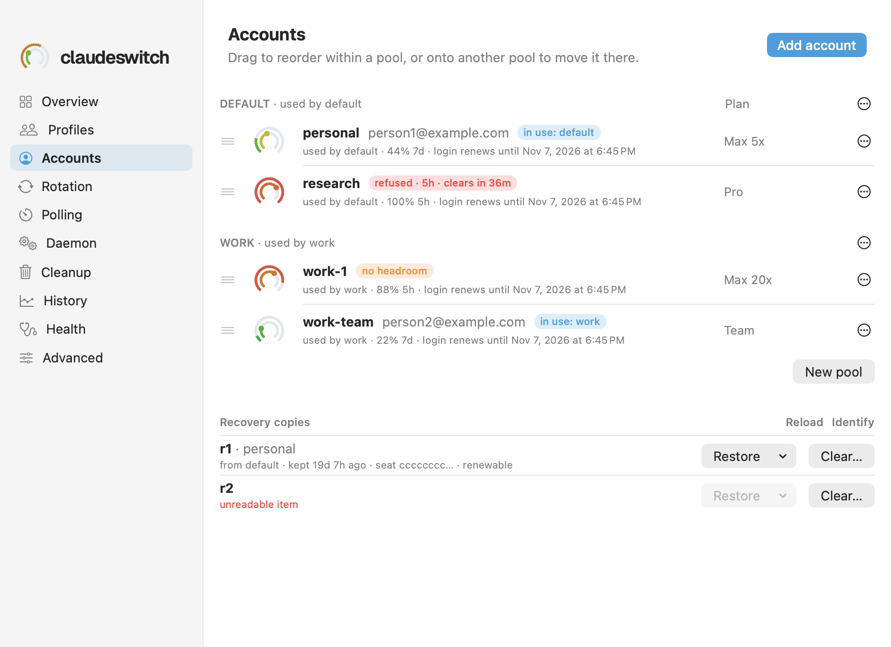

# Settings → Accounts

Every stored account, grouped by the pool it is in and in rotation order within each, with what you can do to each, and the recovery copies.

See also: [cs accounts](../cli/accounts.md) · [cs pool](../cli/profiles.md#pool) · [Settings → Profiles](settings-profiles.md) · [Add account](add-account.md) · [Claude in Chrome in the app](chrome.md) · [GUIDE → Recovery copies](../GUIDE.md#recovery-copies)

<p align="center"></p>

## Pools

Accounts are grouped into named pools, one pool per account. Each profile
lists the pools it uses, in order: it takes an account from a later pool
only when nothing in an earlier one is usable. Profiles that list the same
pool share its accounts, one profile at a time
([PROFILES.md §10](../PROFILES.md)). A profile with `pool = [...]` in its
block has its own pool, named after it. Accounts no pool lists are used by
the profile named `default`, after its pools.

The pane has one section per pool, in the order `cs pool list` gives them,
then **In no pool** when some account is in none:

```
PERSONAL · used by default (1st)
TEAM · used by default (2nd), work (2nd)
OPS · used by work (1st)
SPARE · no profile uses it
In no pool · default uses them last
```

A section's header says which profiles use the pool and, when a profile
uses more than one, where this pool comes in its order. A pool no profile
lists says so: its accounts rotate nowhere until one does. With no
`[[profile]]` blocks there is nothing to group, and the pane is one list in
rotation order; so it is with a `claudeswitch` from before pools, with a line
saying to update it.

| control | what it does | CLI |
|---|---|---|
| drag a row within its pool | changes the rotation order: within a pool, the order rotation tries them | `cs priority <ids...>` |
| drag a row onto another pool | moves the account there, after a confirmation saying which profiles gain and lose it | `cs pool move <id> --to <pool>` |
| drag a row onto **In no pool** | takes the account out of its pool: `default` uses it, after its pools | `cs pool remove <pool> <id>` |
| **New pool** | a name, and accounts to start with. An account already in a pool leaves it (the sheet says which, and asks first). No profile uses a new pool until you add it to one ([Profiles → Change...](settings-profiles.md)) | `cs pool create <name> [<ids>]`, then `cs pool move <id> --to <name>` for each that was in a pool |
| **Rename…** (a pool's ⋯ menu) | a new name. Profiles that use it keep it, in the same place in their order; a profile's own pool becomes a pool of its own that the profile uses | `cs pool rename <pool> <new>` |
| **Delete…** (a pool's ⋯ menu) | asks where its accounts go (it starts on a pool the same profiles use, or No pool for default's), says which profiles stop using it and what each is left with, then deletes it | `cs pool delete <name> --to <pool>` or `--no-pool` |

## The list

One row per account. Each row has:

- small rings: the account's week (outer) and session (inner);
- its name, its email when claudeswitch recorded one, and its state:
  `available`, `no headroom`, `refused · 5h · clears in 36m`, `needs login`
  and so on. The account live in a profile says `in use: work` in place of
  `available` (trouble, such as `needs login`, stays beside it): a profile
  that shares its pool takes another account meanwhile;
- a detail line: every profile that may use it (`used by default, work`),
  its binding figure, its own Chrome profile if it has one, its seat
  (shortened), and how long its login renews for;
- its plan.

**Add account** at the top right opens [Add account](add-account.md) with no
profile chosen.

## An account's ⋯ menu

| item | what it does | CLI |
|---|---|---|
| **Rename...** | renames the account everywhere: config, vault, state, Chrome mapping. Needs the daemon stopped | `cs account rename <old> <new>` |
| **Move to pool** → **ops...** | moves it to another pool, after a confirmation, as a drag onto that pool does. **In no pool...** takes it out of its pool | `cs pool move <id> --to <pool>`, `cs pool remove <pool> <id>` |
| **Sign in again...** | opens [Add account](add-account.md) for this account, to replace a dead credential | `cs login <id> --direct` |
| **Move up** / **Move down** | one step in the rotation order | `cs priority` |
| **Open Chrome** | opens the Chrome profile this account uses | `cs chrome open <id>` |
| **Chrome profile: …** | which Chrome profile Claude in Chrome uses for this account: **Same as its profile** (the default), one of **Your Chrome profiles**, or **Create a new one** | `cs chrome forget <id>`, `cs chrome add <id> --existing <name>`, `cs chrome add <id>` |
| **Delete...** | removes the account and its stored credential, after a confirmation that names the account and seat | `cs account delete <id>` |

## Recovery copies

When a swap or a sign-in replaced a live credential that claudeswitch could
not attribute to an account, it kept the old one aside as a recovery copy.

| control | what it does | CLI |
|---|---|---|
| **Show** / **Reload** | reads the list | `cs recovery` |
| **Identify** | looks up who each copy signs in as, one identity call each | `cs recovery --identify` |
| **Restore** → account | puts the copy back as that account's stored credential, after a confirmation | `cs recovery restore <slot> <id>` |
| **Clear...** | deletes the copy | `cs recovery clear <slot>` |

A copy that cannot be read says so in red and cannot be restored.

## Re-login reminders

When an account's sign-in expires within 5 days (its `refresh_expires_at` in
`cs account list --json`), the app posts a notification once a day for that
account: "personal needs signing in within 2 days", or "its login has expired"
once it has. **Sign in…** on the notification, or clicking it, opens Settings
with [Add account](add-account.md) signing that account in again. An account
whose expiry is unknown, or that is disabled, is never reminded. macOS asks
once whether ClaudeSwitch may post notifications.

[← Documentation index](../README.md)
