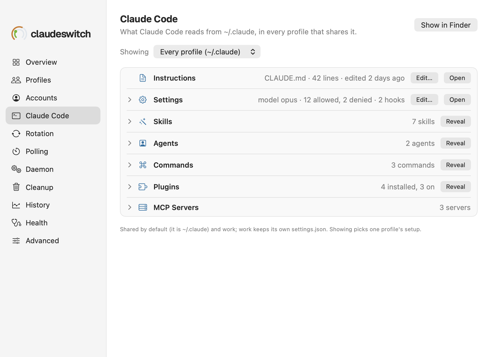
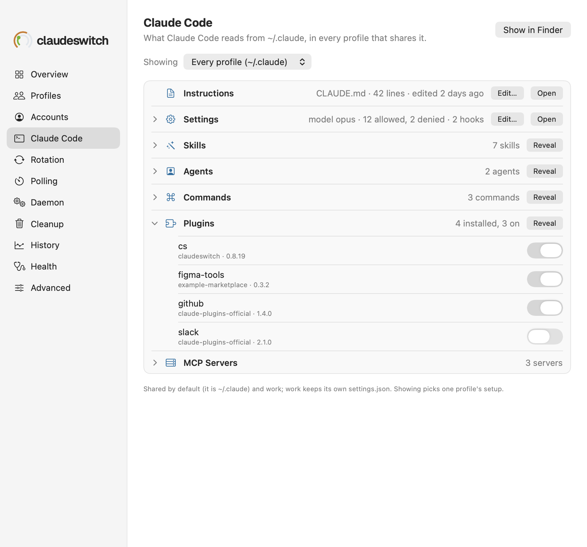
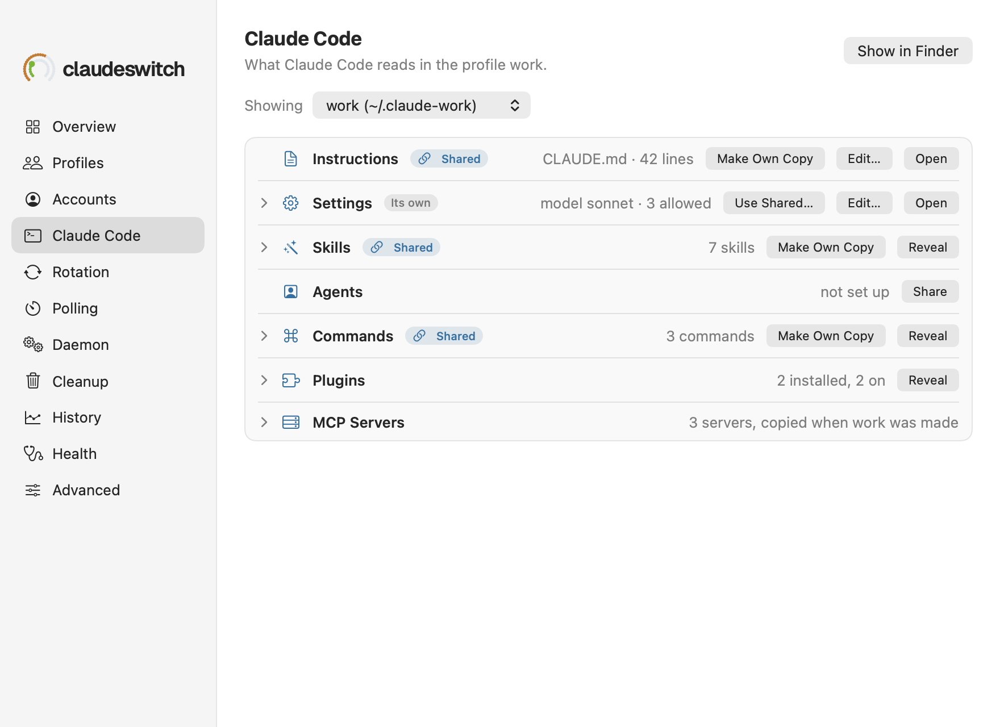
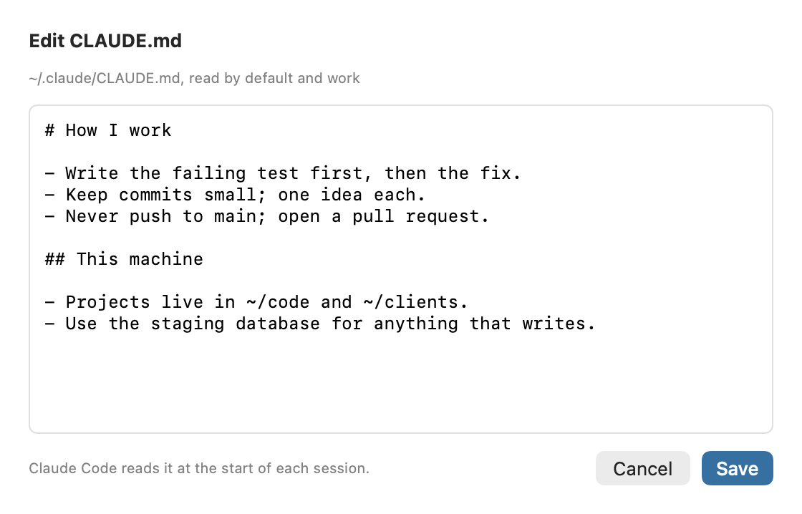

# Settings → Claude Code

What Claude Code reads from `~/.claude`: its instructions, settings, skills, agents, commands, plugins and MCP servers, in every profile that shares them, or in one profile.

See also: [Settings → Profiles](settings-profiles.md) · [cs profile](../cli/profiles.md) · [GUIDE → Making a profile](../GUIDE.md#making-a-profile-and-starting-claude-code-in-one) · [Popover](popover.md)

**Claude Code** in the Settings sidebar, after Accounts, opens this pane;
**Show in Claude Code** in a profile's card in
[Settings → Profiles](settings-profiles.md#an-open-profile) opens it
showing that profile. **Show in Finder**, at the top right, opens the
folder shown (`~/.claude`, or the profile's directory).

## Showing

With more than one profile, **Showing** under the title picks what the pane
shows:

- **Every profile (~/.claude)**, the first choice: `~/.claude` itself, which
  the profile whose directory it is reads, and which every other profile
  reads through the items it shares. A line under the list says who shares it
  and what each other profile keeps of its own: `Shared by default (it is
  ~/.claude) and work; work keeps its own settings.json.`
- **a profile**, by its name and its directory when that is not `~/.claude`
  (`work (~/.claude-work)`): what Claude Code reads there, following its
  links, with how the profile has each item (below). The title's line says
  `What Claude Code reads in the profile work.`

The choice lasts while the app runs; the pane opens on every profile again
after a restart.

## The list

One row per kind of thing Claude Code reads. A row with items has a chevron;
click the row to unfold them, and again to fold them away.

| row | the summary | unfolded | buttons | CLI |
|---|---|---|---|---|
| **Instructions** | `CLAUDE.md · 42 lines · edited 2 days ago`; `not set up` when there is none | | **Edit…**, **Open** | `cs claude show` |
| **Settings** | settings.json in figures: `model opus · 12 allowed, 2 denied · 2 hooks`; `no settings` for `{}`; `not valid JSON: …` when it does not parse | its model, permissions, hooks, status line and environment, which says only how many variables it sets: `3 variables, values hidden` | **Edit…**, **Open** | `cs claude show` |
| **Skills** | `7 skills` | each skill's name and description | **Reveal** | `cs claude show` |
| **Agents** | `2 agents` | each agent's name and description | **Reveal** | `cs claude show` |
| **Commands** | `3 commands` | each command, `/standup`, and its description | **Reveal** | `cs claude show` |
| **Plugins** | `4 installed, 3 on` | each plugin, its marketplace and version, and a switch that turns it on or off | **Reveal** | `cs claude plugin enable\|disable <plugin>` |
| **MCP Servers** | `3 servers` (one profile's: `3 servers, copied when work was made`) | each server's name, how it runs and where: `http · mcp.linear.example`, `stdio · npx` | | `cs claude show` |

- **Open** opens the file in the app your Mac opens it with, or in TextEdit
  when none does. **Reveal** selects the folder in Finder.
- **Edit…** opens the file in the app's own editor (below).
- **A plugin's switch** runs Claude Code's own `claude plugin enable` or
  `disable` for the profile shown (with every profile shown, for the profile
  whose directory is `~/.claude`), then reads the list again. It can take a
  few seconds; a spinner shows meanwhile, and a refusal shows as an alert with
  Claude Code's message. In a screenshot the switches are drawn as macOS draws
  them in a window that is not in front, grey whether on or off; on or off
  shows in the knob's side.

The pane never shows a value from settings.json's `env`, nor an MCP
server's arguments, headers or the path of its URL: only how many variables
there are, and a server's host or the name of its command.

## One profile

Showing a profile other than `~/.claude`'s, each of the five things a profile
can share (CLAUDE.md, settings.json, skills, commands and agents) has a badge
for how the profile has it, and the button that changes that:

| badge | what it means | button | CLI |
|---|---|---|---|
| **Shared** (a link, in the accent) | a link to the same item in `~/.claude`: a change there is a change here | **Make Own Copy** replaces the link with a copy of what it points to, from then on the profile's own | `cs profile own 
 <item>` |
| **Linked elsewhere** | a link to something outside `~/.claude` | **Make Own Copy** | `cs profile own 
 <item>` |
| **Its own** | the profile's own file or folder | **Use Shared…** asks first, then keeps the profile's own beside it as a backup (`settings.json.claudeswitch-20261028-101500`) and links it to `~/.claude`'s | `cs profile share 
 <item>` |
| none, `not set up` | the profile has none | **Share** links it to `~/.claude`'s | `cs profile share 
 <item>` |

A note says what was done (`work now shares settings.json with ~/.claude;
its own is kept as settings.json.claudeswitch-20261028-101500`), and a
refusal shows as an alert with the CLI's message and hint.

## Edit…

**Edit…** on Instructions or Settings opens **Edit CLAUDE.md** or **Edit
settings.json**: the file the profile shown reads, and under the title which
profiles read it (`~/.claude/CLAUDE.md, read by default and work`). For a
profile whose file is a link to `~/.claude`'s, the line says saving changes it
for every profile that shares it.

The editor is plain text in a monospaced font, with no smart quotes or dashes,
text replacement or spelling correction, so what you type is what is saved.
The app reads the file itself and saves it through the CLI, which writes it in
one step. **Save** (⌘S) is greyed until the text changes. The sheet stays
open, with your text, when the CLI refuses:

- settings.json that is not valid JSON: `settings.json is not valid JSON:
  invalid character '}' looking for beginning of object key string (line 8,
  column 1)`; nothing is written;
- the file changed since the sheet opened (another editor, or Claude Code):
  `CLAUDE.md changed since it was opened`, with `reopen it to see the
  change`; nothing is written.

A file larger than 1 MiB, or one that is not UTF-8 text, does not open here:
use **Open**. A missing CLAUDE.md opens empty, and **Save** creates it.

CLI: `cs claude write <CLAUDE.md|settings.json> [--profile 
] --if-unchanged <sha256>`,
the text on standard input.

## When it reads

The pane runs `cs claude show --json` when it opens and after every change,
and `cs claude show --profile 
 --json` for a profile chosen in Showing. A
read that fails says so inline with the CLI's message, and **Try Again**; a
reread that fails keeps what was read and says so above it.

## With an older claudeswitch

`claude show` is new in claudeswitch 0.8.20. With an older binary the pane
says `This needs claudeswitch 0.8.20 or later.`, and nothing else changes.

The screenshots are drawn from fixture data (`macos/scripts/gen-render-fixtures.py`).

[← Documentation index](../README.md)
