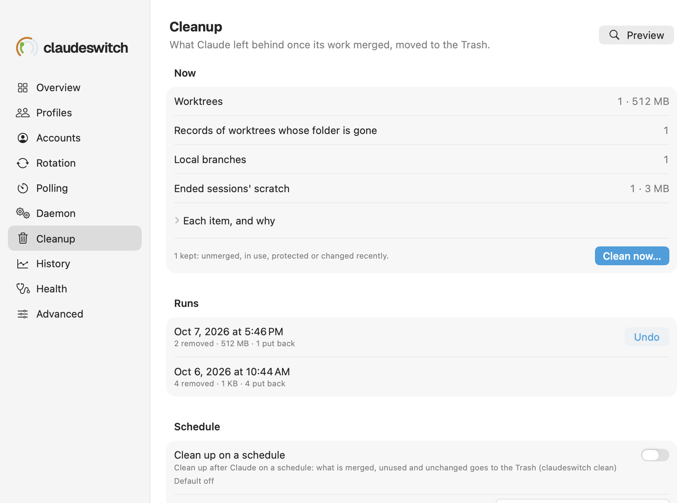

# Settings → Cleanup

What Claude left behind once its work merged (worktrees, branches, lane
clones, ended sessions' scratch, old plugin versions), moved to the Trash,
reversibly.

See also: [cs clean](../cli/clean.md) · [cs clean → the rules](../cli/clean.md#the-rules) · [Settings → Daemon](settings-daemon.md)

The pane has four sections: **Now** (the plan and its result), **Runs**,
**Schedule** and **What it removes**.

**Preview** runs `cs clean --json`: it looks through every repository Claude
Code has run in, in every profile, and changes nothing. It can take a minute
on a machine with hundreds of worktrees. The plan lists what would go by
kind, with counts and sizes; **Each item, and why** opens the list (the first
500), and the line under it counts what is kept and says when it looked
(`1 kept: unmerged, in use, protected or changed recently. Looked 3m ago.`).
`cs clean --all` in a terminal says why for each one.

Under it, the plan says what it did not judge: the folders it did not look
in because macOS asks before anything reads them (`Not looked in (macOS asks
first): ~/Documents, …`, the first five), and, for each reason pull requests
could not be read, how many items it kept that may be merged already
(`Pull requests not checked: gh not found, so 3 kept may be merged
already.`).

**Clean now…** asks first, with the total and the counts, then runs
`cs clean --apply --plan=<the preview> --json`: only the items the preview
shows move, each judged again just before it does, so anything that changed
since stays, and anything found since waits for the next preview. The
result says what moved, what stayed and what failed.

**Runs** lists the last five runs, newest first, with what each removed and
what has been put back (`2 removed · 512 MB · 1 put back`). **Undo**, on a
run with something left to put back, runs `cs clean undo <run> --json`:
branches come back from `refs/archive`, folders from the Trash while they
are still there. It can take minutes: meanwhile **Now** says `Putting back
run <id>…` with a spinner, and Preview and the other Undo buttons wait. Then
it says what came back: `Put back 2 of 2 from run <id>.`

**Schedule** holds the first three rows below, **What it removes** the rest.

| row | key | what it does | default |
|---|---|---|---|
| **Clean up on a schedule** | `clean` | the daemon runs the cleanup itself, every **Every**; a dry-run daemon only plans | off |
| **Every** | `clean_every` | how often the scheduled cleanup runs | 24h (at least 1h) |
| **Only once unchanged for** | `clean_after` | only what has not changed (a commit, a merge, a file written) for this long | 72h |
| **Worktrees and branches** | `clean_worktrees` | merged worktrees and local branches, and git's records of worktrees whose folder is gone | on |
| **Lane clones** | `clean_clones` | second clones beside a project whose every branch is merged | on |
| **Temp files** | `clean_temp` | ended sessions' scratch folders, plugin versions no session uses, old subagent transcripts | on |
| **Subagent transcripts after** | `clean_transcripts_after` | with temp files on, an ended session's subagent transcripts this old go (0 keeps them) | 720h (30 days) |
| **Branches on GitHub** | `clean_remote_branches` | also delete a merged pull request's branch on GitHub, when it is exactly the merged tip | off |
| **Never remove** | `clean_keep` | globs matched against paths, folder names and branch names (comma-separated) | none |
| **Also look in** | `clean_roots` | more folders to look for repositories in (comma-separated) | none |

The on/off rows are switches; changing one runs `cs config set`, like every
other setting, and a typed value is saved when you press Return or leave
the field ([Rotation](settings-rotation.md) says how values are checked and
shown). With a CLI that predates cleanup the pane says it cannot read
the plan, and the rows are absent.

[← Documentation index](../README.md)
