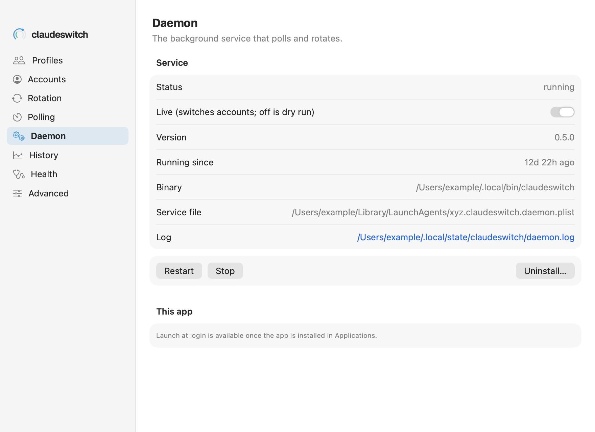

# Settings → Daemon

The background service that polls and rotates: its status, its mode, and starting, stopping, installing and removing it.

See also: [cs daemon](../cli/daemon.md) · [Concepts → dry run and live](../concepts.md#dry-run-and-live) · [GUIDE → Running as a daemon](../GUIDE.md#running-as-a-daemon)

The pane reads `cs daemon status --json` each time it is shown, since what
it said before may no longer be true.

## Service

| row or control | what it shows or does | CLI |
|---|---|---|
| **Status** | running; loaded, not running; installed, stopped | `cs daemon status` |
| **Live (switches accounts; off is dry run)** | turning it on asks first ("Turn the daemon live?"), then makes the daemon act in every profile. Off is dry run: it decides and logs, and changes nothing | `cs daemon live` / `cs daemon dry-run` |
| **Version** | the running daemon's build | |
| **Running for** | how long it has run (`3h`) | |
| **Last poll** | how long ago the daemon last read an account (`1m ago`) | |
| **Binary** | the binary the service runs. A warning appears when that is not the binary this app uses | |
| **Service file** | the launchd plist (`~/Library/LaunchAgents/xyz.claudeswitch.daemon.plist`) | |
| **Log** | `~/.local/state/claudeswitch/daemon.log`; click to open it | |
| **Restart** | restarts it, for example after installing a new binary | `cs daemon restart` |
| **Stop** / **Start** | stops or starts it, leaving it installed | `cs daemon stop` / `cs daemon start` |
| **Uninstall…** | unloads the service and removes its file, after a confirmation. State, logs and stored accounts stay | `cs daemon uninstall` |

Paths under your home folder are shown with `~`. The screenshot's version
and paths are example data.

## Not installed, or not read

The pane says **The daemon service is not installed.** only when the CLI
says so. It then offers **Install (dry run)** and **Install live…**, which
install the service for the binary the app uses; Live asks first
(`cs daemon install --dry-run` / `cs daemon install --live`).

When the status cannot be read, the pane says why, with **Try Again**, and
offers nothing to install: a failed read is not a missing service. **Reading the service…** shows while it reads.

**Open ClaudeSwitch at login**, under Daemon until 0.8.18, is now in
[Settings → Advanced](settings-advanced.md) with the app's other
preferences.

[← Documentation index](../README.md)
