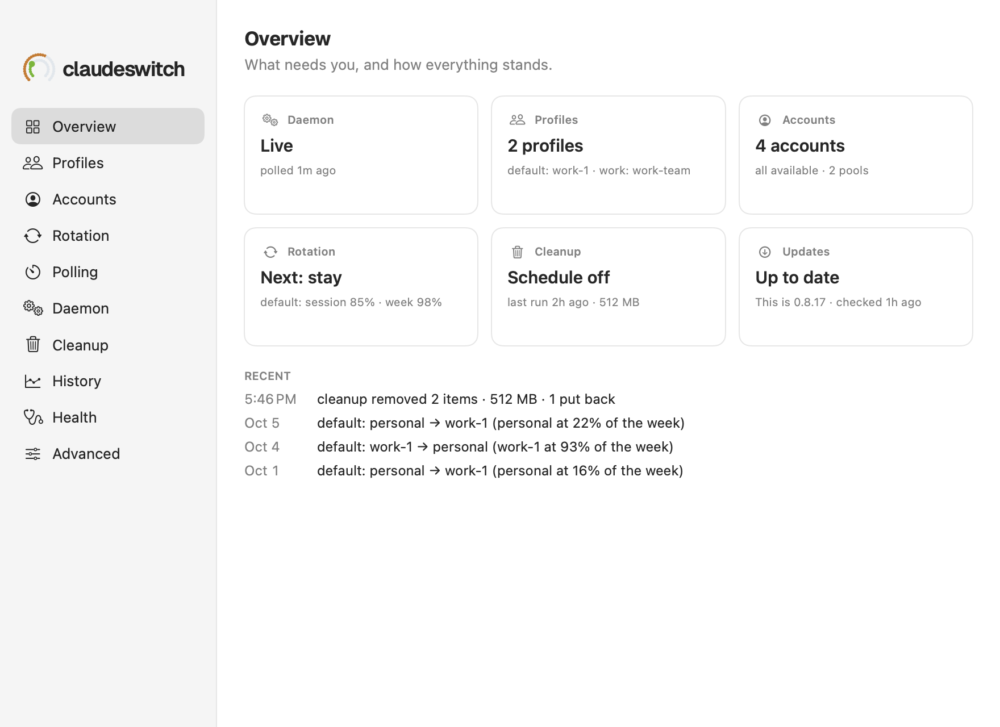

# Settings → Overview

The Settings window's first page: what needs you, how each area stands, and
what happened last. Each tile opens its own pane.

See also: [Popover](popover.md) · [Settings → Profiles](settings-profiles.md) · [Updates](updates.md)

**Needs you** appears only when something does, each with a button that
acts on it or goes where it is fixed:

| it says | the button |
|---|---|
| `claudeswitch is not installed, or not where this app looks.`, or that it is too old for this app (or too new) | **Open Advanced**, where the binary is chosen |
| `The daemon is not installed: nothing switches by itself`, or `The daemon has not polled for 21m` | **Open Daemon** |
| `work-1 needs sign-in` | **Sign in…**: starts that account's sign-in, as the popover's does ([Add account](add-account.md), over Settings → Accounts) |
| `Claude in Chrome in "Work" does not follow switches to work-team` | **Give work-team its own Chrome profile**: creates one and opens it at the sign-in pages, as the [popover's banner](popover.md#banners) does |
| `2 health checks fail` (in the last `cs doctor` run) | **Open Health** |
| `ClaudeSwitch 0.5.6 is available` | **Update…** (the [update window](updates.md)) |

The tiles, each opening its pane. **Updates** opens the update window, on
the offer when there is one or with a check; while the check is off it
opens [Settings → Advanced](settings-advanced.md) instead, where it is
turned on. A tile with something to look at (trouble, or an update) is
drawn in amber.

| tile | what it shows |
|---|---|
| **Daemon** | Live or Dry run, and when it last polled (`polled 1m ago`); Not installed (`nothing switches by itself`) or Not polling (`for 21m`). Once Settings has read `cs daemon status`, its mode and whether the service is installed count over the state file |
| **Profiles** | the only profile's name, with its account, session and week (`work-1 · 3% · week 41%`), or how many, with each one's account (`default: work-1 · work: work-team`). Profiles not signed in come first (`1 not signed in · …`) |
| **Accounts** | how many, then how many need sign-in, have no headroom, were refused, are unknown, or were read before a window reset (`1 read before a reset`), and the number of pools. It says `all available` only when every account is |
| **Rotation** | the next decision of the first profile (`Next: stay`), then when its pool runs dry at this pace (`pool runs dry in 3h 20m`), or its thresholds (`session 85% · week 98%`). With several profiles it names the profile those figures are from (`default: …`) |
| **Cleanup** | Daily, Every …, or Schedule off, then the last run's age and size (`last run 2h ago · 512 MB`) or `no run yet` ([Settings → Cleanup](settings-cleanup.md)) |
| **Updates** | Up to date, a newer version (`0.5.6 available`), Last check failed, Not checked yet (before the first check), Version unknown (a build with no version, from `swift run`), or Check is off; then this version (`This is 0.8.18`) and when it last checked or failed |

**Recent** lists the last few switches (from `cs history --usage`, read
again once it is five minutes old) and the last cleanup run (`cleanup
removed 2 items · 512 MB`), newest first, four at most. With several
profiles each switch names its profile.

[← Documentation index](../README.md)
