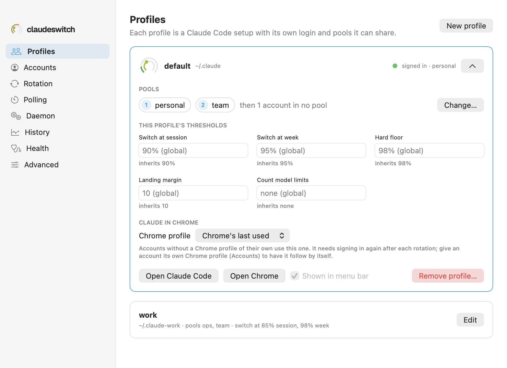
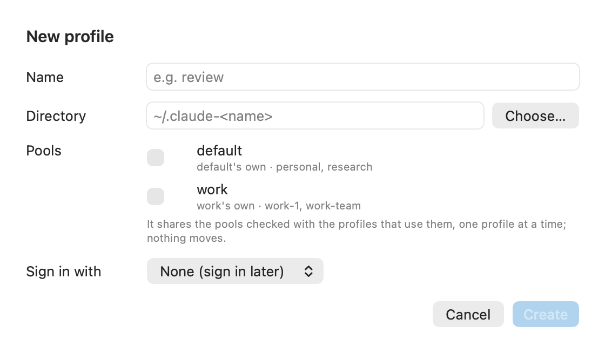

# Settings → Profiles

Create, edit and remove Claude Code profiles: their pools, their own thresholds and their Chrome profile.

See also: [cs profile](../cli/profiles.md) · [Concepts → profiles and pools](../concepts.md#profiles-and-pools) · [GUIDE → Multiple Claude Code profiles](../GUIDE.md#multiple-claude-code-profiles) · [PROFILES.md](../PROFILES.md)

**Profiles** in the Settings sidebar opens this pane (the window itself
opens on [Overview](settings-overview.md); its Profiles tile comes here
too). **New Profile**, at the top right, is the pane's one button for a
new profile. One card per profile, the one the menu bar follows open.

A closed card shows the directory (the home folder as `~`), the pools it
uses (`pools personal, team, then 1 in no pool`) and its thresholds as
every other view says them (`session 90% · week 95%`) in one line,
whether it is signed in, and **Edit**, which opens it. The rings at
the top left of an open card are the live account's week and session.
On either card the dot and text at the right say whether the profile is
signed in and as which account: `signed in · work-1`, or
`needs sign-in · old-sso` (the account last live there) for one whose
login is gone. A long name keeps its room; the directory beside it gives
way first. At the window's least width an open card's buttons take two
lines, **Remove Profile…** on its own, so **Shown in menu bar** stays on
one.

With a CLI from before shared pools, each card lists its accounts in
place of its pools, and the top of the pane says once to update
claudeswitch to group accounts into pools.

## The only profile

A config with no `[[profile]]` blocks has one profile, `default`, marked
**the only profile**: every account belongs to that one setup. Its card
says so and has no pools or thresholds of its own to edit, only **Open
Claude Code** and the menu-bar checkbox. **New Profile**, above it, makes
the first split ([New profile](#new-profile)).

## An open profile

| control | what it does | CLI | default |
|---|---|---|---|
| **POOLS** | the pools the profile uses, numbered in the order it uses them: an account in a later pool only when nothing in an earlier one is usable. A profile with its own pool shows it under its own name. `default` ends with the accounts in no pool (`then 1 account in no pool`). One that uses none says `Uses no pool`, whatever pools the set has. Hover a pool for its accounts. Which pool each account is in is set in [Accounts](settings-accounts.md) | `cs profile list` (`pools`) | |
| **Change…** | a sheet, **Choose the Pools “work” Uses**, listing every pool with a checkbox (a click on the pool's name ticks it too). Under each name, whose it is or who uses it, then its accounts: `its own pool · personal`, `a profile’s own pool · work-1, work-2` (another profile's, which goes by that profile's name), `used by “default”, “work” · team-1, team-2`. The checked ones are numbered in the order the profile uses them, in a column kept from the start, and once two are checked ↑ and ↓ order them. **Save** sets them. Checking another profile's own pool shares it: that profile keeps using it (one sentence for all of them: `The pools “a” and “b” belong to the profiles of the same name: …`). Unchecking this profile's own pool, when it holds accounts, leaves them in a pool no profile uses. The sheet says either in a note under the pools before you save. A refusal (an account live where it would stop being usable, `live`) shows in the sheet | `cs profile pools 
 <pool>...` (twice when its own pool is dropped: the CLI converts it first and keeps it first unless named) | |
| **FOLDERS** | the folders that pick this profile: `cs run` with no name in one of them runs this profile, and `cs profile which` says so. Globs, comma-separated (`~/work/**, ~/clients/**`); empty clears them. Hidden with a CLI that does not report `paths` | `cs profile set 
 paths <glob,glob>` | none |
| **Switch at session** | this profile's `switch_at`. Empty inherits the global value, shown in the empty field; ↺ goes back to inheriting | `cs profile set 
 switch_at <n>` | inherit (85) |
| **Switch at week** | this profile's `switch_at_weekly` | `cs profile set 
 switch_at_weekly <n>` | inherit (98) |
| **Hard floor** | this profile's `hard_floor` | `cs profile set 
 hard_floor <n>` | inherit (99) |
| **Landing margin** | this profile's `landing_margin` | `cs profile set 
 landing_margin <n>` | inherit (10) |
| **Count model limits** | this profile's `models` | `cs profile set 
 models <list>` | inherit (none) |
| **Spend first** | this profile's `prefer`: **Inherit**, **Most room** or **Expiring quota** (a menu) | `cs profile set 
 prefer room\|expiring` | inherit (Most room) |
| **Chrome profile** | the Chrome profile Claude in Chrome is used from for this profile's accounts that have none of their own. Lists your Chrome profiles by name | `cs profile set 
 chrome <name>`; `inherit` for the default | Chrome’s last used |
| **Open Claude Code** | your terminal running Claude Code in this profile. Off while it opens, so a double click opens one; off for a profile that needs sign-in | `cs run 
` | |
| **Open Chrome** | opens the live account's Chrome profile. Off while it opens | `cs chrome open <id>` | |
| **Shown in menu bar** | the menu bar follows this profile. On the profile it follows, checked; on `default` it cannot be unchecked, since the menu bar would follow `default` anyway (its help says so). Check it on another profile to follow that one | | `default` |
| **Remove Profile…** | a sheet, **Remove the profile “work”?**, that says first what removing does (the profile gets no card and is not rotated), then where its own accounts go (its own pool, and for `default` the accounts in no pool, to the profile you choose), and that the pools it lists stay: those it shares, and those only it uses (`the pool it shares (“team”) and the pool only it uses (“ops”) stay`). No profile uses a pool of the second kind once it is gone, so an orange note names the accounts left rotating nowhere: `No profile uses “ops” then: its account “ops-1” rotates nowhere until a profile lists it.` The sheet asks where its accounts go only when it has some to move, and always for `default`: `cs profile remove default` needs `--to`, since the accounts in no pool are default's. With none of its own to move, `default`'s picker reads **Accounts in no pool go to** and the sheet says why it asks even when there are none. Then that its directory and saved login stay on disk, and which account stays guarded until that login is gone or you release it with **Forget…** (below). The sheet is the confirmation: its **Remove “work”** button removes it | `cs profile remove 
 --to <other> --yes` | |
| **Sign In…** (only when it **needs sign-in**) | a menu of its accounts: signs the profile in with the one chosen. One live in another profile says `in use by “work”` and cannot be chosen | `cs profile seed 
 <id>` | |

The threshold fields check what you type against the setting's range and show
the CLI's own message when it refuses. An empty field inherits: its
placeholder is the global value, and the line under it says `inherits the
global value`. A percent field has its `%` beside it, so `75` reads as the
global `90%` does; once it overrides, the line says `overrides the global
90%` (or `overrides the global value (none)` when the global value reads
none) and ↺ goes back to inheriting. A value is saved on Return, when you
click away, and when the card is closed or Settings closes while you type,
if it is valid and changed. More on what each threshold does:
[Settings → Rotation](settings-rotation.md).

## New profile

| field | what it is | default |
|---|---|---|
| **Name** | the profile's name | |
| **Directory** | its Claude Code config directory; **Choose…** picks one | `~/.claude-<name>` |
| **Its accounts** (when some account is in no pool) | accounts in no pool, which `default` uses now, to make the new profile's own. With no `[[profile]]` blocks yet, that is every account. One live somewhere says so | none |
| **Pools** | the pools it uses, checked and ordered as in **Change…**, used in the order numbered; its own accounts come first. Profiles that use the same pool share its accounts; each account is live in one profile at a time. No account moves. With no pools yet, or a CLI from before them, one line says so | none |
| **Sign in with** | the account the new profile starts signed in as: one of its own, or of the pools checked, but not one live in another profile | None (sign in later) |

**Create** stays off until the profile has a name, and says so beside it:
`Enter a name to continue.` A profile that would start with no accounts
(none of its own checked, and no checked pool with any) can be created,
but a note says so first: `It starts with no accounts: check a pool, or
add one later.` (naming what the sheet offers: its accounts, a pool, or
neither).

**Create** runs `cs profile create <name> [--dir <dir>] [--pool <ids>]`,
then `cs profile pools <name> <pools...>` and `cs profile seed <name> <id>`
when chosen. If `profile create` fails the form stays, and **Create** tries
again. Once the profile exists, a later step that fails turns the sheet
into what was done ("The profile “lab” was created, but giving it its pools
failed.") with the CLI's message, **Retry**, which runs only the steps left,
and **Close**, which leaves the profile as it is. What creating does to
the directory (links to your settings, a copy of your MCP servers):
[GUIDE → Making a profile](../GUIDE.md#making-a-profile-and-starting-claude-code-in-one).

## Old profiles still holding a credential

A removed or repointed profile's last login stays guarded, so that account
is not swapped into another profile while it might still be live there. This
section, under the cards, lists them; **Forget…** releases one
(`cs profile forget 
`) once confirmed, and the note after it says so:
`Forgot the old login of “work-2” in “old”`.

[← Documentation index](../README.md)
