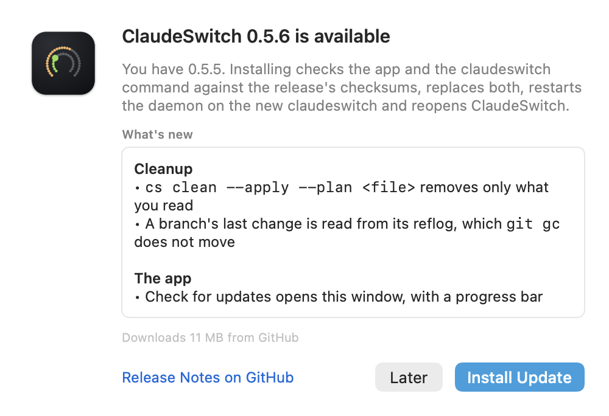
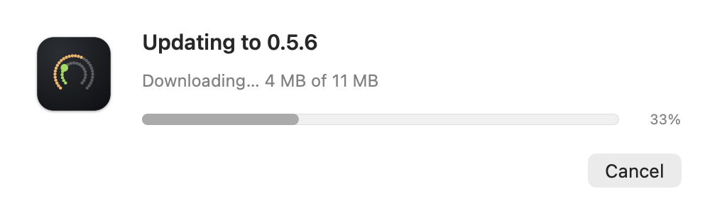

# Updates

The app checks once a day for a newer release, shows what it found in an
update window, and updates the app and the `claudeswitch` binary together
under a progress bar.

See also: [Popover](popover.md) · [Settings → Advanced](settings-advanced.md) · [Settings → Daemon](settings-daemon.md)

## The check

Once a day the app makes one unauthenticated call to GitHub:
`GET https://api.github.com/repos/<owner>/claudeswitch/releases/latest`
for the public repository, https://github.com/bogdan-alexandrescu/claudeswitch,
whichever tree the app was built from (before 0.8.9 a build from a source
tree other than the public one asked an address that does not exist, and
never offered an update). It compares the release's tag with
the app's own version and ignores drafts and pre-releases. A failed daily
check is logged (subsystem `xyz.claudeswitch.menubar`, category `flows`)
and tried again the next day.

| control | where | what it does | default |
|---|---|---|---|
| **Check for updates** | Settings → Advanced → This app | off makes no call at all, and hides an offer already found | on |
| **Check now** | under it | checks at once and opens the update window | |
| **Check for updates…** | the popover's ⋯ menu | the same | |

## The update window

**Check for updates…** and **Check now** open it, and it says what the
check found: **Checking for updates…**, **ClaudeSwitch is up to date**,
**Could not check for updates** (why, with **Try Again**), or the offer.
A newer release found by the daily check shows at the popover's foot as
**0.5.6 available · Update…**, which opens the same offer.

The offer names the version and the one you have, shows **What's new**
(the release's notes; GitHub's "Full Changelog" line is left out), how much
it downloads, and **Release Notes on GitHub**. **Later** closes it;
**Install Update** starts the install.

## Install Update

The progress bar follows each step, and the popover's foot shows it too
(click it to bring the window back). Install:

1. reads the latest release again;
2. downloads the app zip (`ClaudeSwitch-<version>-macos.zip`), its
   `.sha256`, this Mac's binary archive
   (`claudeswitch_<tag>_darwin_arm64.tar.gz` or `…_darwin_amd64.tar.gz`)
   and `checksums.txt` (**Downloading… 4 MB of 11 MB**);
3. checks both downloads against their published SHA-256, before anything
   is changed;
4. unpacks them in a temporary folder (`tar`, `ditto`);
5. replaces the binary the app runs (the one in Settings → Advanced →
   claudeswitch, followed through links to the file itself) with
   `install -m 0755` (**Installing claudeswitch…**);
6. moves the running app aside and puts the new bundle in its place
   (**Installing ClaudeSwitch…**);
7. restarts the daemon on the new binary (`claudeswitch daemon restart
   --json`; no daemon installed is fine);
8. relaunches the app, which opens the window once more to say **ClaudeSwitch
   is now 0.5.6**. Sheets and dialogs still open (an editor in Settings, an
   alert) are closed first, dropping what was typed in them, since an open
   one refuses the quit; a helper waits for the old app to go, ends it if it
   is still there after five seconds, then opens the new one.

**Cancel** works while it downloads and checks: nothing has been replaced
yet, and the offer comes back. From step 5 on it is greyed out, since half
an update is worse than a whole one. Closing the window does not stop an
install.

**Any failure leaves both as they were** and says why in the window (**The
update did not install**, with **Try Again**): a download that fails or does
not match its checksum stops before anything is touched; a binary or app
that cannot be replaced (a folder you cannot write, say) is put back; a
daemon that will not restart on the new binary puts both back and restarts
it on the old one.

The new app is ad-hoc signed like the release zip. Downloaded by the app
itself, it is not quarantined, so it opens without the Gatekeeper prompt a
browser download meets.

[← Documentation index](../README.md)
