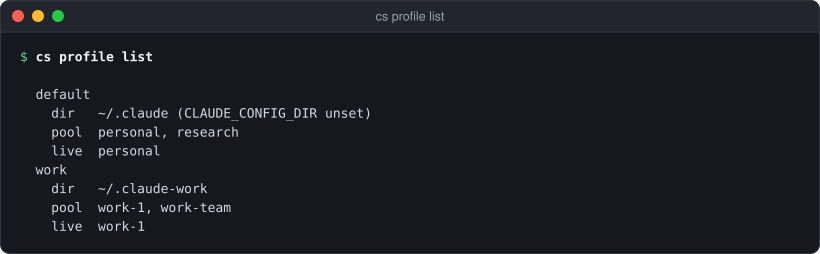

# cs profile

Create, list, seed, edit and remove Claude Code profiles, share pools of
accounts between them, and start Claude Code in one.

See also: [Concepts → profiles and pools](../concepts.md) · [Settings → Profiles](../app/settings-profiles.md) · [GUIDE → Multiple Claude Code profiles](../GUIDE.md#multiple-claude-code-profiles) · [docs/PROFILES.md](../PROFILES.md) · [APP_CLI → profile](../APP_CLI.md#profile)

A profile is one Claude Code config directory that rotates over the accounts
of its pools. `default` is the profile with no `dir`: Claude Code with
`CLAUDE_CONFIG_DIR` unset (`~/.claude`). With no `[[profile]]` blocks in the
config, everything is one implicit `default` profile.

A profile's accounts come either from its own pool (`pool = [...]` on the
profile, a pool named after it that only it uses) or from the named pools it
lists (`pools = [...]`, each a `[[pool]]` block). An account is in one pool.
Profiles that list the same pool share its accounts, one profile at a time:
an account live in one profile is "in use by" it in every other.

```
claudeswitch profile create <name> [--dir PATH] [--pool a,b] [--seed <account>]
claudeswitch profile seed <name> <account>
claudeswitch profile list
claudeswitch profile remove <name> [--to <profile>] [--yes]
claudeswitch profile forget <name>
claudeswitch profile pools <name> <pool>...
claudeswitch profile pool <name> add|remove <account> [--to <profile>]
claudeswitch profile set <name> <key> <value|inherit>
claudeswitch profile which [--dir PATH]
claudeswitch profile hook zsh|bash|fish
claudeswitch run [<profile>] [-- claude arguments]

claudeswitch pool list
claudeswitch pool create <name> [<account>...]
claudeswitch pool add <pool> <account>
claudeswitch pool remove <pool> <account>
claudeswitch pool move <account> --to <pool>
claudeswitch pool rename <pool> <new-name>
claudeswitch pool delete <name> [--to <pool> | --no-pool]
```

Every `profile` and `pool` subcommand takes `--json` and `--config PATH`.

| flag | applies to | meaning | default |
|---|---|---|---|
| `--config PATH` | all | the config file to read and edit | `~/.config/claudeswitch/config.toml` |
| `--json` | all | one JSON object on stdout, never a prompt | off |
| `--dir PATH` | `create` | the profile's `CLAUDE_CONFIG_DIR` | `~/.claude-<name>` |
| `--pool a,b` | `create` | comma-separated accounts it rotates within | empty |
| `--seed <account>` | `create` | a vaulted account from the pool to sign it in with | none |
| `--to <profile>` | `remove`, `pool … remove` | the profile whose pool the accounts join instead | none |
| `--to <pool>` | `pool move`, `pool delete` | the pool the account (or the deleted pool's accounts) goes to | required for `move`; no pool for `delete` |
| `--no-pool` | `pool delete` | the deleted pool's accounts go to no pool; the profile named `default` uses them last | the default |
| `--yes` | `remove` | do not ask for confirmation | off |
| `--dir PATH` | `which` | the folder to ask about | the current folder |

## profile create

```sh
cs profile create work --pool work-1,work-team --seed work-1
```

Makes the directory (`~/.claude-<name>` unless `--dir`), links your
`settings.json`, `CLAUDE.md`, `skills/`, `commands/` and `agents/` from
`~/.claude` into it, copies your user-scope MCP servers, writes the
`[[profile]]` block, and with `--seed` signs it in with that account's vaulted
credential. With no `[[profile]]` blocks yet it declares `default` too. Every
step and every refusal is described in
[GUIDE → Making a profile](../GUIDE.md#making-a-profile-and-starting-claude-code-in-one).

`--pool` makes the profile's own pool. An account already in a pool, another
profile's own or a `[[pool]]`, is refused (`in_other_pool`), naming that pool:
an account is in one pool. To share it, make the profile without it and list
its pool: `cs profile pools <name> <pool>`. If a running daemon does not load the new profile within 10
seconds, the profile is made but not signed in (`daemon_not_loaded`), and
`cs profile seed` finishes it.

`--json` prints the new profile as `profile list --json` describes one, plus
`"seeded"`: the account, or `null`. The human progress lines go to stderr.

## profile seed

```sh
cs profile seed work work-1
```

Signs a profile that has no credential yet in with an account's vaulted
credential. The account must be in one of the profile's pools and live in
no other profile. A profile with no `dir` (`default`) cannot be seeded: only a
profile's own credential is ever written, never the one Claude Code uses with
`CLAUDE_CONFIG_DIR` unset.

`--json`: `{"profile": "work", "seeded": "work-1"}`.

## profile list

```sh
cs profile list
```

<p align="center"></p>

Each profile's directory, pool and the account recorded live in it. A
profile that lists pools has a `pools` line instead, each pool with its
accounts in the order the profile uses them:
`pools mine (p1), then team (t1, t2)`. `live`
reads `none recorded` before the daemon has recorded one, and adds
`; not signed in` when the profile has no credential. A profile with
`paths` (below) has a `paths` line too.

`--json` lists every profile with its dir, pool, the names of its pools
(`pools`), live and pinned account,
whether it is signed in, its overrides, its effective thresholds and its
Chrome profile, plus the guarded old credentials (`ghosts`) and every pool
(`pools`, as `pool list --json` gives them). The exact shape
is in [APP_CLI → profile](../APP_CLI.md#profile).

## profile remove

```sh
cs profile remove work --to default
```

Removes a `[[profile]]` block. Its own pool's accounts move to `--to`, or to
`default`; into a profile that lists pools, they join the first one it lists.
The `[[pool]]` blocks it listed stay as they are, for any other profile that
lists them; one no profile lists any more is named in the output, since its
accounts then rotate nowhere. Only the config changes: the profile's folder and its credential
stay. The account last live there may still be in use by a running session, so
it is guarded and installed nowhere else until that credential no longer holds
it, or until `cs profile forget <name>`.

Refusals:

- the last profile (`last_profile`);
- `default` while other profiles exist, without `--to` (`usage`);
- `--to` naming the profile being removed (`usage`);
- an enabled account that would end up in no pool (`would_orphan`).

It asks before removing. `--yes` skips the question; with `--json` or no
terminal and no `--yes` it refuses with `confirmation_required`.

## profile forget

```sh
cs profile forget work
```

Releases the guard on a removed or re-pointed profile's old credential, so its
account can be used elsewhere again. It prints
`released N guarded credential(s) of profile work; its account(s) may be used elsewhere again`.
With nothing guarded for that profile it fails with `not_found` and lists the
profiles that are guarded. `cs status` and `cs doctor` list guarded
credentials.

`--json`: `{"profile": "work", "released": 1}`.

## profile pools

```sh
cs profile pools work team
cs profile pools default mine team
```

Sets the pools a profile uses, in the order it uses them: an account in a
later pool is chosen only when no account in an earlier one is usable. Each
name is a `[[pool]]` block, or a profile's own pool, which goes by the
profile's name (`pool list` shows both). Two profiles that list one pool
share its accounts, one profile at a time.

A profile with its own pool (`pool = [...]`) has it converted first: a
`[[pool]]` named after the profile takes its accounts, and leads the list
unless the list names it somewhere else. Naming another profile's own pool
converts that one the same way, and that profile then lists it, so both
share it. Nothing is lost: each profile can use the accounts it could before.

It prints `profile work uses team, in that order; a running daemon picks this
up by itself`, and a line for each pool it converted. Refusals: an unknown
pool or profile (`not_found`), a pool named twice (`invalid_value`), no pools
(`usage`), and an account a profile stops using while it is or may be live
there (`live`). Sharing an account with the profile it is live in is fine.

`--json` answers with the profile as `profile list --json` describes one.

## profile pool

```sh
cs profile pool work add work-team
cs profile pool default remove research --to work
```

Edits a profile's own pool. `add` puts an account in it. An account is in
one pool, so one another pool lists is refused (`in_other_pool`); for a
profile's own pool move it with `remove … --to`, which takes it out of one
pool and into another in one edit, and for a `[[pool]]` the hint names
`cs pool move` and `cs profile pools`.
`remove` without `--to` refuses to leave an account in no pool
(`would_orphan`). An account that is or may be live in the profile it leaves
is refused (`live`), with the `cs use` command that frees it. A profile that
lists pools has no own pool to edit: `profile pool` on it is a `usage` error
pointing to `cs pool`, and so is `--to` naming one.

It prints `work-team is now in profile work's pool; a running daemon picks
this up by itself`. `--json`: `{"account", "profile", "changed", "pools"}`.

## pool

```sh
cs pool list
cs pool create team work-1 work-2
cs profile pools default mine team
cs profile pools work team
cs pool move work-3 --to team
cs pool remove team work-2
cs pool rename team shared
cs pool delete old --to shared
```

Named pools of accounts, the `[[pool]]` blocks in the config:

```toml
[[pool]]
name     = "team"
accounts = ["work-1", "work-2"]

[[profile]]
name  = "default"
pools = ["mine", "team"]

[[profile]]
name  = "work"
dir   = "~/.claude-work"
pools = ["team"]
```

- `list`: every pool with its accounts and the profiles that use it, each
  profile's own pool under the profile's name, and the accounts in no pool
  (the profile named `default` uses those, after its pools).
- `create <name> [<account>...]`: a new `[[pool]]`, appended to the config.
  A name another pool or a profile's own pool has is `invalid_value`; an
  account already in a pool is `in_other_pool`, naming it. No profile uses a
  new pool until one lists it (`profile pools`).
- `add <pool> <account>`: an account in no pool joins one. One in another
  pool is `in_other_pool`: move it instead.
- `remove <pool> <account>`: the account is then in no pool, so `default`
  uses it. With no `default` profile that would leave it unusable, which the
  config refuses: `would_orphan`.
- `move <account> --to <pool>`: out of its pool and into another, in one
  edit.
- `rename <pool> <new-name>`: the pool takes the new name, and every profile
  that lists it keeps it in the same place (below).
- `delete <name> [--to <pool> | --no-pool]`: any pool, a profile's own
  included. Its accounts go to `--to`'s pool, or to no pool, and the profiles
  that listed it stop listing it (below). A binary from before D38 answered
  `pool_in_use` for a pool a profile lists.

A pool name is a profile's own pool when no `[[pool]]` has it, so
`cs pool add solo s2` edits `pool = [...]` on the profile `solo`.

Every edit changes only the lines it is about, keeps comments, and is parsed
back before it replaces the file. An account a profile stops using while it
is, or may be, live there is refused (`live`), as is one a profile starts
using while it is live in a profile that cannot use it. Each `--json` answer
is the `pool list` object:

```json
{"pools": [
  {"name": "team", "accounts": ["work-1", "work-2"], "profiles": ["default", "work"], "own": false},
  {"name": "mine", "accounts": ["personal"], "profiles": ["default"], "own": false},
  {"name": "solo", "accounts": ["s1"], "profiles": ["solo"], "own": true}],
 "unlisted": ["spare"]}
```

### pool rename and pool delete

`cs pool rename <pool> <new-name>` (D39) renames a `[[pool]]` where it is
written, with every profile's listing of it, so its comments and its place in
each profile's order stay. A profile's own pool, renamed, becomes a `[[pool]]`
of the new name that the profile lists instead. A name another pool has is
refused (`invalid_value`).

`cs pool delete <name>` (D38) deletes any pool, a profile's own included. Its
accounts go to `--to <pool>`, or to no pool (`--no-pool`, the default), and
every profile that listed it stops listing it. It is refused when an account
in use in a profile would land where that profile cannot use it (`live`), or
in no pool with no profile named `default` to use it (`would_orphan`).

## profile set

```sh
cs profile set work switch_at 75
cs profile set work models none
cs profile set work chrome "Work"
cs profile set work switch_at inherit
```

A per-profile override. The keys are the settings marked *profile* in
[cs config](config.md#settings): `switch_at`, `switch_at_weekly`,
`hard_floor`, `landing_margin`, `prefer`, `models`, plus `chrome`.

- `inherit` (or an empty value) removes the override, so the global value
  applies.
- Percentages must be in (0, 100].
- For `prefer`, the value is `room` or `expiring`
  ([concepts → How rotation decides](../concepts.md#how-rotation-decides)).
- For `models`, `none` is an empty list: this profile counts no model's
  weekly limit, whatever the global setting says.
- For `chrome`, the value is a Chrome profile's name ("Work") or folder
  (`Profile 2`); `inherit` means Chrome's last used. See
  [cs chrome](chrome.md).

It prints `profile work: switch_at = 75`, or
`profile work: switch_at inherits the global value (85)`. A profile not
declared in the config (no `[[profile]]` blocks) has only the global settings
(`not_found`, with the `cs config` command to use instead).

`--json`: `{"profile", "key", "override", "effective", "path"}`; for `chrome`,
`override` is the folder or `null`.

### Folders: `paths`

```sh
cs profile set work paths "~/src/work/**,~/clients/acme"
cs profile set work paths inherit
```

`paths` are the folders a profile is picked for (IMPROVEMENTS F4): `cs run`
with no name, `cs profile which` and the shell hook use them. In the config:

```toml
[[profile]]
name  = "work"
dir   = "~/.claude-work"
pool  = ["work-1", "work-2"]
paths = ["~/src/work/**", "~/clients/acme"]
```

- A pattern is absolute or from your home (`~/…`). Within one folder name
  `*` is any run of characters and `?` one character; a whole `**` is any
  number of folders, none included. `[…]` and `\` are refused, and so are
  `.` and `..` folders.
- A folder belongs to a pattern when the pattern matches it **or one of its
  parents**: `~/src/work` and `~/src/work/**` pick the same folders, and
  `~/clients/*` covers everything inside each client folder.
- Two profiles whose paths could both match one folder are refused when the
  config loads (`profiles "default" and "work" have paths that overlap`),
  like an account in two pools. One profile's own patterns may overlap.
- A folder is matched as given, then with its links resolved.
- `a,b` sets several (no comma inside a pattern); `inherit` (or `""`)
  removes them. A pattern that would overlap another profile's is
  `invalid_value` and nothing is written.

`--json` for `paths`: `override` and `effective` are lists (`override` is
`null` after `inherit`, `effective` then `[]`).

## profile which

```sh
cs profile which
cs profile which --dir ~/src/work/api --json
```

The profile a folder picks: the one whose `paths` it belongs to, else
`default`. It reads the config alone (no state, no keychain).

```
  work  (~/src/work/** matches /Users/person1/src/work/api)
```

`--json`:

```json
{"dir": "/Users/person1/src/work/api", "profile": "work", "pattern": "~/src/work/**",
 "rule": "paths", "config_dir": "~/.claude-work", "from_env": false}
```

`rule` is `paths` (a pattern matched; `pattern` names it), `default` (none
did: `pattern` is `null`) or `none` (none did and there is no `default`
profile: `profile` and `config_dir` are `null`). `config_dir` is the
profile's `dir` as written, `null` for the profile without one (Claude Code
with `CLAUDE_CONFIG_DIR` unset). With no `[[profile]]` blocks the answer is
the implicit `default`, `from_env` `true`.

## profile hook

```sh
# ~/.zshrc
eval "$(claudeswitch profile hook zsh)"
# ~/.bashrc
eval "$(claudeswitch profile hook bash)"
# ~/.config/fish/config.fish
claudeswitch profile hook fish | source
```

Prints an optional shell hook. When the folder changes (zsh `chpwd`, bash
`PROMPT_COMMAND`, fish `--on-variable PWD`) it runs
`claudeswitch profile which --hook` and sets `CLAUDE_CONFIG_DIR` to the
folder's profile's `dir`, or unsets it for the profile without one, exactly
as `cs run` would start Claude Code there. It never runs anything else and
never evaluates what the binary prints. Where no profile is picked (no
`default`, no `[[profile]]` blocks, or a config that does not load) it
leaves `CLAUDE_CONFIG_DIR` as it is. A value you export by hand lasts until
the next change of folder.

`profile which --hook` prints the one line the hook reads: `set <dir>`,
`unset` or `keep`.

## run

```sh
cs run work
cs run work -- --resume
cs run            # this folder's profile
```

Starts `claude` with `CLAUDE_CONFIG_DIR` set to the profile's directory (unset
for the profile with no `dir`). With no name it starts the profile this
folder picks (`profile which`): the one whose `paths` the folder is under,
noting `profile "work" (~/src/work/** matches this folder)`, else
`default`; with neither it refuses, naming the profiles. Arguments after `--` go to `claude`. It replaces
itself with `claude`, so the exit status is Claude Code's. A profile that is
not signed in yet starts anyway, after the note
`profile "work" is not signed in yet — use /login, then claudeswitch takes over`.

`run` takes `--config PATH` and no `--json`. It fails if the profile does not
exist (naming the ones that do) or `claude` is not on `PATH`.

## Which profile other commands act on

`use`, `add`, `login` and `whoami` act on the profile named by `--profile`,
else the one your shell's `CLAUDE_CONFIG_DIR` belongs to:
[GUIDE → Which profile a command acts on](../GUIDE.md#which-profile-a-command-acts-on).

## Exit status

- `0`: done.
- `1`: refused or failed. With `--json` the error is
  `{"error": {"code", "message", "hint", "retry_at"}}` on stdout; the codes
  are in [APP_CLI → Error codes](../APP_CLI.md#error-codes).
- `2`: `run` with a flag it does not know.

[← Documentation index](../README.md)
